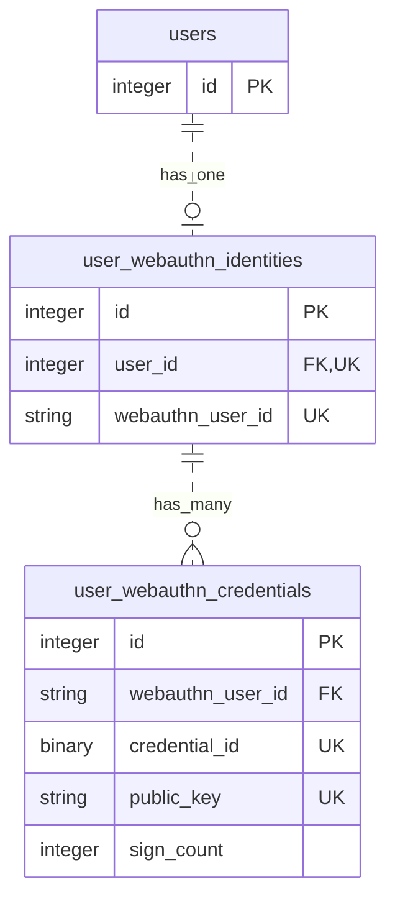

# 設計

## 前提・実装範囲

登録は認証済みユーザーによる操作を想定しています。サンプルでは認証を省き、seed で用意した最初のユーザーを登録対象に固定しています。

復元は未ログインを想定し、credential ID から登録済みの公開鍵を探して署名を検証します。復元成功後のログイン・トークン発行は実装していません。入力不正などのエラーハンドリングも簡略化しています。

## DB 設計

各テーブルの `created_at`・`updated_at` は図から省略しています。

credential は 1 ユーザーにつき複数件持てます。`credential_id` と `public_key` はそれぞれ全体で一意で、どちらかが登録済みのものと重複する鍵は登録できません。登録用 options の `excludeCredentials` に登録済みの `credential_id` を含めるため、同じ認証器の二重登録はクライアント側で弾かれます。identity は登録用 options 取得時に作るため、公開鍵登録前は credential が存在しません。

`credential_id` は認証器が生成するバイト列で、[WebAuthn Level 3 の仕様](https://www.w3.org/TR/webauthn-3/#credential-id)では最大 1023 バイトと定められています。そのため `binary` 型（`limit: 1024`）で保存し、`WebAuthn::Credential` の Base64URL 文字列 `id` ではなく、デコード済みバイト列の `raw_id` を格納します。SQLite では `blob(1024)` になりますが、SQLite は型の長さ制限を強制しないため、この上限は MySQL などの RDBMS で有効になります。ログや API レスポンスで扱う際は `UserWebauthnCredential#credential_id_base64` で Base64URL 文字列に変換します。登録用 options の `excludeCredentials` も、この変換結果を渡しています。
なお Base64URL 文字列のまま `string`（VARCHAR）で保存しない理由は 1023 バイトを Base64URL にすると 1364 文字になり、MySQLの[インデックスキー長の上限 3072 バイト](https://dev.mysql.com/doc/refman/8.0/en/innodb-limits.html)に対して utf8mb4 の VARCHAR(1364) は超えるため、一意インデックスを作成できないため。`binary`（VARBINARY(1024)）であればキー長が上限内に収まり、バイト列として比較されるのでどちらの問題も起きません。SQLite にはインデックスキー長の実質的な上限がなく、TEXT の比較も既定では大文字小文字を区別する BINARY 照合のため、VARCHAR でも一意インデックスは機能します。それでも `binary` にしているのは、MySQL などへの移行時に挙動が変わらないようにするためになっています。お使いのアプリケーションの特性に合わせて適宜カスタマイズしてください。

`sign_count` は認証器の署名カウンターです。登録時の値を保存し、復元のたびに認証器から受け取った値で更新します。復元時は保存値より大きい値だけを受け付けるため、鍵が複製された場合の再利用を検知できます。カウンターに対応しない認証器は常に 0 を返すので、保存値も 0 のまま検証を通過します。

credential と identity は、主キー `id` ではなく WebAuthn 用のユーザー ID `webauthn_user_id` で紐づきます。詳細は [スキーマ](../db/schema.rb) を参照してください。

## API 設計

すべて POST・JSON で、成功時は HTTP 200 を返します。

リクエスト・レスポンスの具体的な値は、`lib/tasks` のスクリプトの実行出力、または [成功時のログ](../lib/tasks/sample_result.log)・[失敗時のログ](../lib/tasks/sample_failure.log) を参照してください。

| 手順 | エンドポイント | リクエスト | 成功応答 |
| --- | --- | --- | --- |
| 1 | `/api/v1/registration/options` | `{}` | `requestId` と、`publicKeyOption` に登録用 options（`challenge`、`rp`、`user` など） |
| 2 | `/api/v1/registration` | 手順 1 の `requestId` と、登録レスポンスを格納した `credential` | 公開鍵を登録し、`{"status":"ok"}` |
| 3 | `/api/v1/recovery/options` | `{}` | `requestId` と、`publicKeyOption` に復元用 options |
| 4 | `/api/v1/recovery` | 手順 3 の `requestId` と、署名レスポンスを格納した `credential` | 署名カウンターを更新し、`{"success":true}` |

登録用・復元用 options の `challenge` を、それぞれ次の手順で使用します。復元用 options は未登録でも取得でき、`allowCredentials` は空配列です。登録済みかどうかは手順 4 で判定します。

| エラー条件 | HTTP | 応答 |
| --- | --- | --- |
| 登録時の `requestId` が無効、またはチャレンジが期限切れ | 422 | `{"error":"Registration request is no longer available"}` |
| 復元時の `requestId` が無効、またはチャレンジが期限切れ | 422 | `{"error":"Recovery request is no longer available"}` |
| 復元時に credential が未登録 | 404 | `{"error":"Credential not found"}` |
| 復元時の署名カウンターが保存値以下 | 422 | `{"error":"WebAuthn::SignCountVerificationError"}` |
| 検証処理で `WebAuthn::Error` が発生 | 422 | `{"error":"<e.message>"}` |
| 検証後のチャレンジ削除に失敗 | 422 | `error` に `Registration request is no longer available` または `Recovery request is no longer available` |

## チャレンジの管理

- 登録用・復元用とも options 取得時に `requestId` を発行し、`requestId` ごとにチャレンジを保持します。同じユーザーが同時に複数の登録を進めても互いに干渉しません。
- 発行・取り出し・削除は `WebauthnChallengeRequest`（`app/lib`）に共通化し、用途（`registration` / `recovery`）でキャッシュキーを分けています。
- 有効期限は 30 分です。開発環境ではプロセス内のメモリーを使うため、サーバー再起動で失われ、複数プロセス間では共有されません。
- 同じチャレンジで並行処理が進むのを防ぐため、検証後の削除に成功した要求だけを先に進めます。登録では DB 更新より先に削除するため、DB 更新に失敗してもチャレンジは戻りません。

## 設定と実装の参照先

FakeClient は [WebAuthn 設定](../config/initializers/webauthn.rb) の origin を使います。HTTP の接続先とは別なので、API を localhost で動かしても origin を変更する必要はありません。

API の詳細は [登録処理](../app/controllers/api/v1/registrations_controller.rb)・[復元処理](../app/controllers/api/v1/recoveries_controller.rb)、実行手順とログ例は [README](../README.md) を参照してください。
