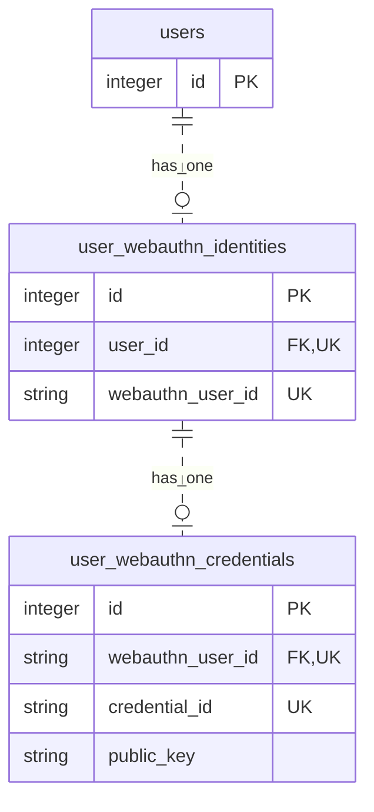

# 設計

## 前提・実装範囲

登録は認証済みユーザーによる操作を想定しています。サンプルでは認証を省き、seed で用意した最初のユーザーを登録対象に固定しています。

復元は未ログインを想定し、credential ID から登録済みの公開鍵を探して署名を検証します。復元成功後のログイン・トークン発行、署名カウンターの保存・更新は実装していません。入力不正などのエラーハンドリングも簡略化しています。

## DB 設計

各テーブルの `created_at`・`updated_at` は図から省略しています。

サンプルを簡潔にするため、credential は 1 ユーザーにつき 1 件です。identity は登録用 options 取得時に作るため、公開鍵登録前は credential が存在しません。

credential と identity は、主キー `id` ではなく WebAuthn 用のユーザー ID `webauthn_user_id` で紐づきます。詳細は [スキーマ](../db/schema.rb) を参照してください。

## API 設計

すべて POST・JSON で、成功時は HTTP 200 を返します。

リクエスト・レスポンスの具体的な値は、`lib/tasks` のスクリプトの実行出力、または [成功時のログ](../lib/tasks/sample_result.log)・[失敗時のログ](../lib/tasks/sample_failure.log) を参照してください。

| 手順 | エンドポイント | リクエスト | 成功応答 |
| --- | --- | --- | --- |
| 1 | `/api/v1/registration/options` | `{}` | 登録用 options（`challenge`、`rp`、`user` など） |
| 2 | `/api/v1/registration` | 登録レスポンスをリクエスト直下に格納 | 公開鍵を登録・更新し、`{"status":"ok"}` |
| 3 | `/api/v1/recovery/options` | `{}` | `recovery_id` と復元用 `options` |
| 4 | `/api/v1/recovery` | 手順 3 の `recovery_id` と、署名レスポンスを格納した `credential` | `{"success":true}` |

登録用・復元用 options の `challenge` を、それぞれ次の手順で使用します。復元用 options は未登録でも取得でき、`allowCredentials` は空配列です。登録済みかどうかは手順 4 で判定します。

| エラー条件 | HTTP | 応答 |
| --- | --- | --- |
| 登録時に登録用 options を未取得、またはチャレンジが期限切れ | 422 | `{"error":"Registration request is no longer available"}` |
| 復元時に credential が未登録 | 404 | `{"error":"Credential not found"}` |
| 検証処理で `WebAuthn::Error` が発生 | 422 | `{"error":"<e.message>"}` |
| 検証後のチャレンジ削除に失敗 | 422 | `error` に `Registration request is no longer available` または `Recovery request is no longer available` |

## チャレンジの管理

- 登録用はユーザーごとに保持し、options の再取得で上書きします。復元用は `recovery_id` ごとに保持します。
- 有効期限は 30 分です。開発環境ではプロセス内のメモリーを使うため、サーバー再起動で失われ、複数プロセス間では共有されません。
- 同じチャレンジで並行処理が進むのを防ぐため、検証後の削除に成功した要求だけを先に進めます。登録では DB 更新より先に削除するため、DB 更新に失敗してもチャレンジは戻りません。

## 設定と実装の参照先

FakeClient は [WebAuthn 設定](../config/initializers/webauthn.rb) の origin を使います。HTTP の接続先とは別なので、API を localhost で動かしても origin を変更する必要はありません。

API の詳細は [登録処理](../app/controllers/api/v1/registrations_controller.rb)・[復元処理](../app/controllers/api/v1/recoveries_controller.rb)、実行手順とログ例は [README](../README.md) を参照してください。
